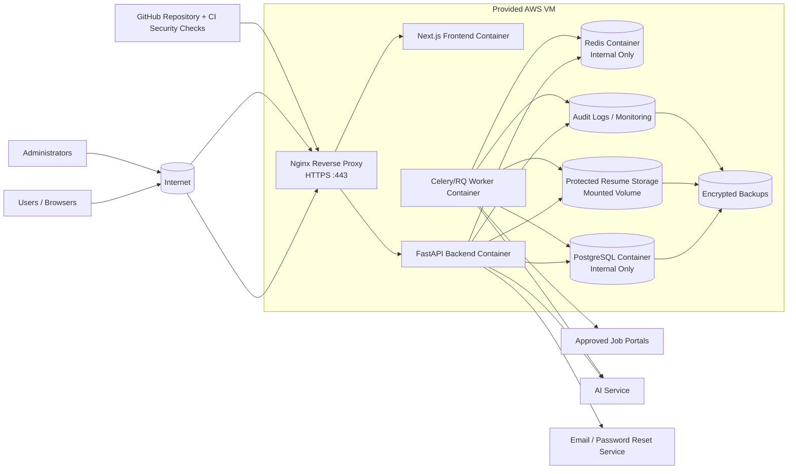
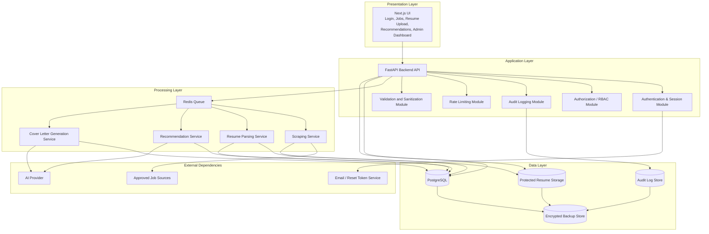
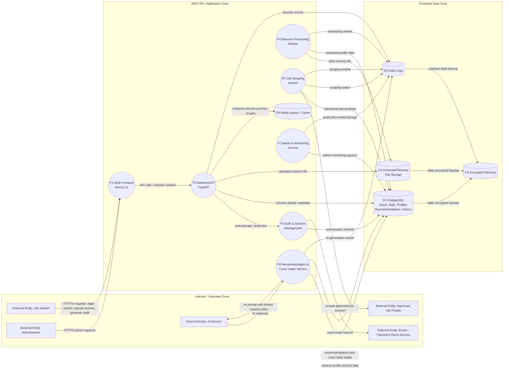

# Secure Architecture

## 1. Architecture Goals

The architecture must support:

- Secure account and profile management.
- Secure resume upload and processing.
- Weekly job aggregation from approved sources.
- Searchable normalized job data.
- AI-assisted recommendation and cover letter drafting.
- Saved jobs and application preparation history.
- Admin monitoring, scraping review, job moderation, audit logs, and platform health review.
- Strong security controls for authentication, authorization, logging, file upload, external data, AI prompts, and deployment.
- Deployment on the provided AWS VM, with the web frontend served from that VM.

Security is part of the architecture, not an add-on. The system must follow secure-by-design principles:
- Minimize attack surface.
- Establish secure defaults.
- Enforce least privilege.
- Use defense in depth.
- Fail securely.
- Do not trust external services or user input.
- Separate duties between normal users and administrators.
- Avoid security by obscurity.
- Keep security mechanisms simple and reviewable.
- Fix security issues correctly rather than hiding symptoms.

---

## 2. Application Context

This project is a secure AI-assisted job aggregation and application support platform.

The system allows job seekers to:
- Register, log in, log out, change password, reset password, update profile, and delete account.
- Browse, search, filter, save, and view job postings.
- Upload and replace resumes.
- Extract structured resume data such as skills, education, work history, and years of experience.
- Generate job recommendations.
- Generate and edit cover letter drafts.
- View application preparation history.

The system allows administrators to:
- Manage users.
- Review scraping outcomes.
- Disable or delete invalid, duplicate, malformed, or suspicious jobs.
- Monitor scraping tasks.
- View platform activity and audit logs.

The system integrates with:
- Approved external job sources.
- An AI service for recommendation and cover letter support.
- An email service for password reset.
- An embedded authentication risk engine for login scoring, trusted device cookies, and a separate risk-admin dashboard.
- GitHub and CI security tools for secure development checks.

---

## 3. Main Stakeholders and Actors

| Actor | Type | Description |
|---|---|---|
| Job Seeker | External user | Uses the platform to browse jobs, upload resumes, receive recommendations, and generate cover letter drafts. |
| Administrator | Privileged user | Manages users, monitors scraping, reviews jobs, views logs, and investigates suspicious activity. |
| Approved Job Portal | External system | Provides job postings for scheduled scraping. |
| AI Service | External system | Generates recommendations or cover letter content from limited required data. |
| Email Service | External system | Sends password reset emails. |
| Developer / DevOps Maintainer | Internal stakeholder | Builds, deploys, patches, monitors, and maintains the system. |
| Attacker / Mis-actor | Threat actor | Attempts account takeover, data leakage, injection, malicious upload, prompt injection, DoS, or privilege escalation. |

---

## 4. Recommended Technology Stack

| Layer | Recommended Technology | Responsibility | Security Role |
|---|---|---|---|
| Frontend | Next.js + React + TypeScript + Tailwind CSS | Login/register UI, job browsing, resume upload, recommendation and cover letter pages, admin dashboard | Input constraints, safe display, secure cookie handling |
| Reverse Proxy | Nginx on AWS VM | HTTPS termination, routing to frontend/backend | TLS, security headers, request size limits |
| Backend API | FastAPI + Python | Auth, authorization, jobs API, resume API, AI orchestration, admin API | RBAC, validation, audit logging, rate limiting |
| Authentication Risk Engine | Embedded FastAPI package | Login risk scoring, device-cookie continuity, separate `/risk-engine/admin` dashboard | Risk-based login blocking/challenge signals and risk audit trail |
| Database | PostgreSQL | Users, jobs, profiles, recommendations, cover letters, audit logs | Relational integrity, least privilege access |
| Queue / Cache | Redis | Background job queue and temporary caching | Decouples long-running jobs from web requests |
| Background Worker | Celery or RQ | Scraping, resume parsing, recommendation refresh, cover letter generation | Isolates expensive/untrusted processing |
| File Storage | Protected local storage or mounted volume | Uploaded resumes | Outside public web root, randomized filenames |
| Monitoring / Logs | App logs + audit logs | Security events, scraping status, system health | Accountability, incident investigation |
| CI/CD Security | Semgrep, Bandit, Gitleaks, Trivy | Static analysis, dependency scan, secret scan, image scan | Prevents insecure code/config deployment |

---

## 5. High-Level Physical Architecture

The system is deployed on the provided AWS VM using Docker Compose behind Nginx. The frontend must still be served from the provided AWS VM.



### Physical Architecture Notes

- Nginx is the only public-facing application entry point.
- PostgreSQL and Redis must not be publicly exposed.
- Resume storage, logs, and backups must not be publicly accessible.
- The backend and worker communicate with PostgreSQL, Redis, and file storage over Docker internal networks.
- The worker performs long-running scraping, resume parsing, AI recommendation, and cover letter generation tasks so the web app stays responsive.
- The provided AWS VM should expose only necessary ports:
  - `443` for HTTPS
  - `80` only for redirecting to HTTPS or certificate challenge
  - `22` for SSH, preferably restricted by IP if possible

---

## 6. Logical Architecture



### Logical Layer Responsibilities

| Layer | Responsibilities |
|---|---|
| Presentation | Browser UI, input forms, safe display, user workflows, admin dashboard. |
| Application | Authentication, authorization, session management, validation, rate limiting, business logic, audit logging. |
| Processing | Scraping, resume parsing, recommendation calculation, AI prompt construction, cover letter draft generation. |
| Data | Structured database records, uploaded resume storage, audit logs, backups. |
| Operations | Docker Compose, Nginx, CI/CD checks, monitoring, patching, backup/restore. |

---

## 7. Level 0 Data Flow Diagram

This Level 0 DFD shows external entities, processes, data stores, and trust boundaries.



---

## 8. Trust Boundaries

| Trust Boundary | Description | Required Controls |
|---|---|---|
| Internet / Untrusted Zone to AWS VM | Browser, admin browser, job portals, AI service, and email provider communicate with system over network. | HTTPS/TLS, validation, authentication, rate limiting, safe errors. |
| Frontend to Backend | Frontend sends API requests to backend. | Backend authentication and authorization, do not trust frontend-only checks. |
| Backend to Data Zone | Backend reads/writes database, resume storage, logs. | Least privilege access, parameterized queries, access control, safe logging. |
| Backend to Worker Queue | Backend enqueues long-running tasks. | Task validation, rate limits, minimal sensitive data in queue. |
| Worker to External Job Sources | Scraper receives untrusted external content. | Source allowlist, normalization, sanitization, duplicate/suspicious job control. |
| Backend/Worker to AI Service | System sends selected data to AI provider. | Data minimization, prompt separation, no unnecessary personal data. |
| Application to Backup Store | Critical data is backed up. | Encrypted backups, restricted access, restore tests. |

---

## 9. Key Data Flows

### 9.1 User Login Flow

1. User submits email and password over HTTPS.
2. Backend validates input format.
3. Backend verifies password using Argon2id or bcrypt.
4. Backend creates a secure session with expiry.
5. Session token is returned in a secure cookie.
6. Login success/failure is audit logged.
7. Generic error is returned on failure.

Security controls:
- Password hashing.
- Rate limiting.
- Generic errors.
- Secure session cookie.
- Session token hashing if stored server-side.
- Audit logging.

### 9.2 Resume Upload and Extraction Flow

1. Authenticated user uploads resume.
2. Backend validates ownership/session.
3. Backend checks extension, declared MIME type, content-derived file type, size, file signature, and DOCX archive safety.
4. Backend stores file outside public web root using randomized filename.
5. Resume metadata and file hash are stored in PostgreSQL.
6. Backend enqueues parsing job in Redis.
7. Worker parses file with timeout and resource limits.
8. Extracted profile data is stored in PostgreSQL.
9. Upload and extraction outcomes are audit logged.

Security controls:
- File allowlist.
- MIME/content validation using declared MIME, content signatures, and content-derived type checks.
- DOCX archive limits for file count, total uncompressed size, and compression ratio.
- Randomized filenames.
- Protected storage.
- Worker isolation.
- No full resume content in logs.

### 9.3 Job Scraping Flow

1. Scheduler triggers weekly scraping.
2. Worker fetches jobs only from approved enabled sources.
3. Worker normalizes job data.
4. Worker computes content hash and detects duplicates.
5. Malformed or suspicious jobs are flagged.
6. Valid jobs are stored or updated.
7. Scraping run status is logged for admin review.

Security controls:
- Source allowlist.
- Treat scraped content as untrusted.
- Output encoding on display.
- Duplicate/suspicious job control.
- Scraping audit logs.

### 9.4 Recommendation Flow

1. Authenticated user requests recommendation refresh.
2. Backend verifies ownership of profile/resume data.
3. Backend rate limits the request.
4. Recommendation service compares extracted profile against jobs.
5. Recommendations and rationales are stored.
6. Event is audit logged.

Security controls:
- Authentication.
- Ownership checks.
- Rate limiting.
- Safe storage.
- Audit logging.

### 9.5 Cover Letter Generation Flow

1. Authenticated user selects a job.
2. Backend verifies user session and job availability.
3. Backend retrieves only necessary profile and job fields.
4. Prompt builder separates trusted system instructions from untrusted resume/job content.
5. AI service returns draft text.
6. Draft is stored in `cover_letters`.
7. User can review and edit the draft.
8. The system never auto-submits to external platforms.
9. Generation/editing actions are audit logged.

Security controls:
- Prompt injection mitigation.
- Data minimization.
- Rate limiting.
- Draft-only generation.
- Audit logging.

### 9.6 Admin Monitoring Flow

1. Admin logs in.
2. Backend verifies role `ADMIN`.
3. Admin views users, jobs, scraping runs, audit logs, or health status.
4. Any admin modification is audit logged.
5. Normal users are blocked from admin endpoints.

Security controls:
- Admin RBAC.
- Stronger admin protection.
- Audit logs.
- Failed authorization logging.

---

## 10. Attack Surface Summary

| Attack Surface | Type | Main Threats | Security Controls |
|---|---|---|---|
| Registration page | Entry point | Fake accounts, enumeration, automated abuse | Rate limiting, generic messages, validation |
| Login page | Entry point | Brute force, credential stuffing | Password hashing, rate limiting, account lockout/progressive delay |
| Password reset page | Entry point | Token abuse, account takeover | Time-limited single-use hashed tokens, strict token format validation, generic messages |
| Profile update endpoint | Entry point | XSS, unauthorized data update | Ownership checks, validation, output encoding |
| Resume upload endpoint | Entry point | Malicious file, parser exploit, archive bomb, DoS | File allowlist, declared and content-derived MIME checks, signature checks, DOCX archive limits, size limit, worker isolation |
| Resume extraction worker | Processing surface | Parser vulnerabilities, resource exhaustion | Timeouts, memory limits, dependency scanning |
| Job search/filter API | Entry point | Injection, heavy queries, unsafe exposure of moderated jobs | Parameterized queries, validation, pagination, query limits, admin-only suspicious/inactive job filters |
| Job detail display | Exit point | Stored XSS, malicious content | Sanitization, output encoding, CSP |
| External job redirect | Exit point | Phishing, malicious redirects | HTTPS-only approved source domain validation, rejection of credentialed or malformed URLs, external link warning |
| Scheduled scraper | External integration | Data poisoning, malformed content | Source allowlist, normalization, suspicious job flagging |
| AI recommendation/cover letter/interview-question API | External integration | Prompt injection, data leakage, unsafe AI output shape | Prompt separation, data minimization, strict output schemas where structured output is returned, output review |
| Saved jobs/history API | Data access surface | Broken access control | RBAC, ownership checks |
| Admin dashboard | Privileged surface | Privilege escalation, repudiation | Admin RBAC, audit logging, stronger admin protection |
| Audit logs | Operational data store | Sensitive log exposure, tampering, log bloat | Redaction, access control, bounded detail strings, log integrity protection |
| PostgreSQL | Data store | Data leakage, tampering | Least privilege DB user, ORM/parameterized queries, backups |
| Resume storage | Data store | Personal data leakage | Outside web root, randomized filenames, authorized download only |
| Redis | Internal service | Queue tampering, sensitive data exposure | Internal-only binding, minimal sensitive data |
| Docker/Nginx/AWS VM | Infrastructure | Misconfiguration, exposed ports, debug mode | Firewall, patching, non-root containers, secure config |
| GitHub/CI pipeline | Development surface | Secret leakage, vulnerable dependencies | Gitleaks, Semgrep/Bandit, Trivy, dependency scanning |

---

## 11. STRIDE Threat Mapping

| Component / Flow | STRIDE Category | Threat | Risk Link | Mitigation |
|---|---|---|---|---|
| Login / password reset | Spoofing | Attacker logs in using stolen credentials or abuses reset token. | R2 | Strong password hashing, rate limiting, secure reset tokens, generic errors, session expiry. |
| User profile / resume APIs | Elevation of Privilege | User modifies another user's profile, resume, or cover letters. | R3 | RBAC, ownership checks, server-side authorization. |
| Resume upload | Tampering | Uploaded file is disguised as a valid PDF but contains malicious content. | R4 | File extension, MIME, content validation, size limit, worker isolation. |
| Scraped job data | Tampering | External job content is manipulated before storage. | R5 | Approved sources, normalization, duplicate and suspicious job controls. |
| Job details display | Information Disclosure / Tampering | Stored XSS leaks session or displays malicious job links. | R5 | Output encoding, sanitization, CSP, suspicious URL warning. |
| AI prompt flow | Information Disclosure | Resume data is over-shared with AI service. | R6 | Data minimization, prompt separation, avoid unnecessary personal data. |
| Recommendation / cover letter generation | Tampering | Prompt injection causes the model to ignore intended instructions. | R6 | System prompt isolation, untrusted content delimiters, output review. |
| Search, upload, AI generation | Denial of Service | Repeated requests exhaust CPU, memory, queue, or AI quota. | R7 | Rate limiting, background queue, quotas, monitoring. |
| Audit logs | Repudiation | User or admin denies performing an action. | R8 | Audit logs with timestamp, user ID/session ID, event type, outcome. |
| Audit logs | Tampering | Rogue admin or attacker deletes/modifies logs. | R8 | Restricted log access, append-only logs, log backups. |
| GitHub / deployment pipeline | Information Disclosure | Secrets or private keys are committed to repository. | R9 | Secret scanning, environment variables, secure configuration. |
| Dependencies / containers | Elevation of Privilege | Vulnerable library or container image enables compromise. | R9 | Dependency scanning, container scanning, patching. |
| Backup storage | Information Disclosure | Database or resume backup is leaked. | R10 | Encrypted backups, restricted access, restore testing. |

---

## 12. Security Controls by Layer

| Layer | Security Controls | Threats Addressed |
|---|---|---|
| Presentation | HTTPS, secure cookies, generic login/reset errors, output encoding, CSP | XSS, account enumeration, session theft |
| Application | RBAC, ownership checks, authentication, session expiry, rate limiting, audit logging | Broken access control, account takeover, repudiation |
| Processing | Worker isolation, file validation, task timeouts, queue limits, approved scraping sources | Malicious files, DoS, job poisoning |
| Data | PostgreSQL constraints, least privilege DB user, protected file storage, encrypted backups | Data leakage, tampering, backup exposure |
| Operations | Nginx security headers, firewall rules, Docker isolation, patching, monitoring | Infrastructure compromise, misconfiguration |
| Development | SAST, dependency scanning, secret detection, security testing | Vulnerable dependency, hardcoded secrets, insecure release |

---

## 13. Security Architecture Decisions

### 13.1 Nginx Reverse Proxy

Nginx is used as the single public entry point.

Responsibilities:
- Terminate HTTPS.
- Route requests to frontend/backend containers.
- Add security headers.
- Enforce request size limits.
- Redirect HTTP to HTTPS.

Recommended headers:
- `Strict-Transport-Security`
- `X-Content-Type-Options: nosniff`
- `X-Frame-Options: DENY`
- `Referrer-Policy`
- `Content-Security-Policy`
- `Permissions-Policy`

### 13.2 Backend as Security Enforcement Point

The backend must enforce:
- Authentication.
- Authorization.
- RBAC.
- Ownership checks.
- Input validation.
- Rate limiting.
- Audit logging.
- Safe error handling.

The frontend must never be the only enforcement point.

### 13.3 Background Processing

Long-running or risky operations must run in workers:
- Scraping.
- Resume parsing.
- Recommendation refresh.
- Cover letter generation.

This supports availability and prevents expensive tasks from blocking normal web access.

### 13.4 Protected File Storage

Resume files must be stored:
- Outside public web root.
- With randomized filenames.
- With metadata in database.
- With access only through authorized backend endpoints.

### 13.5 External Service Trust

The system must not fully trust:
- Job portals.
- AI service.
- Email service.
- User browser.
- Uploaded files.

Every external input must be validated, minimized, encoded, logged, or isolated depending on context.

---

## 14. Data Classification

| Data Type | Sensitivity | Examples | Required Protection |
|---|---|---|---|
| Public job data | Low to Medium | Job title, company, location, source | Validate, normalize, encode on display. |
| Account data | High | Email, password hash, role, session metadata | Access control, password hashing, secure sessions. |
| Resume data | High | Uploaded file, extracted text, skills, work history | Protected storage, ownership checks, no public access. |
| Cover letters | High | AI-generated drafts using personal profile | Ownership checks, no unauthorized access. |
| Application history | High | Saved jobs, prepared applications | Ownership checks, audit logs. |
| Audit logs | Medium to High | Login events, admin actions, upload events | Restricted access, no sensitive tokens. |
| Secrets | Critical | DB password, AI key, session secret | Environment variables/secrets only, never in Git. |
| Backups | High | DB dumps, resume storage, audit logs | Encryption, restricted access, restore testing. |

---

## 15. Database Schema

Use PostgreSQL with SQLAlchemy and Alembic migrations.

```sql
CREATE TABLE users (
    id BIGSERIAL PRIMARY KEY,
    email VARCHAR(255) NOT NULL UNIQUE,
    password_hash TEXT NOT NULL,
    role VARCHAR(30) NOT NULL DEFAULT 'USER',
    is_active BOOLEAN NOT NULL DEFAULT TRUE,
    failed_login_count INTEGER NOT NULL DEFAULT 0,
    locked_until TIMESTAMP NULL,
    created_at TIMESTAMP NOT NULL DEFAULT CURRENT_TIMESTAMP,
    updated_at TIMESTAMP NOT NULL DEFAULT CURRENT_TIMESTAMP,
    last_login_at TIMESTAMP NULL
);

CREATE TABLE sessions (
    id BIGSERIAL PRIMARY KEY,
    user_id BIGINT NOT NULL REFERENCES users(id) ON DELETE CASCADE,
    session_token_hash TEXT NOT NULL UNIQUE,
    created_at TIMESTAMP NOT NULL DEFAULT CURRENT_TIMESTAMP,
    expires_at TIMESTAMP NOT NULL,
    revoked_at TIMESTAMP NULL,
    ip_address VARCHAR(64),
    user_agent TEXT
);

CREATE TABLE password_reset_tokens (
    id BIGSERIAL PRIMARY KEY,
    user_id BIGINT NOT NULL REFERENCES users(id) ON DELETE CASCADE,
    token_hash TEXT NOT NULL UNIQUE,
    expires_at TIMESTAMP NOT NULL,
    used_at TIMESTAMP NULL,
    created_at TIMESTAMP NOT NULL DEFAULT CURRENT_TIMESTAMP
);

CREATE TABLE user_profiles (
    user_id BIGINT PRIMARY KEY REFERENCES users(id) ON DELETE CASCADE,
    full_name VARCHAR(255),
    phone VARCHAR(50),
    location VARCHAR(255),
    summary TEXT,
    skills_json JSONB,
    updated_at TIMESTAMP NOT NULL DEFAULT CURRENT_TIMESTAMP
);

CREATE TABLE resumes (
    id BIGSERIAL PRIMARY KEY,
    user_id BIGINT NOT NULL REFERENCES users(id) ON DELETE CASCADE,
    original_filename VARCHAR(255) NOT NULL,
    stored_filename VARCHAR(255) NOT NULL UNIQUE,
    file_path TEXT NOT NULL,
    file_hash VARCHAR(128) NOT NULL,
    mime_type VARCHAR(100) NOT NULL,
    file_size_bytes BIGINT NOT NULL,
    upload_status VARCHAR(30) NOT NULL,
    uploaded_at TIMESTAMP NOT NULL DEFAULT CURRENT_TIMESTAMP
);

CREATE TABLE resume_extractions (
    id BIGSERIAL PRIMARY KEY,
    resume_id BIGINT NOT NULL REFERENCES resumes(id) ON DELETE CASCADE,
    extracted_text TEXT,
    skills_json JSONB,
    experience_json JSONB,
    education_json JSONB,
    years_experience NUMERIC(4,1),
    processed_at TIMESTAMP,
    processing_status VARCHAR(30) NOT NULL
);

CREATE TABLE job_sources (
    id BIGSERIAL PRIMARY KEY,
    source_name VARCHAR(100) NOT NULL UNIQUE,
    base_url TEXT NOT NULL,
    is_enabled BOOLEAN NOT NULL DEFAULT TRUE,
    created_at TIMESTAMP NOT NULL DEFAULT CURRENT_TIMESTAMP
);

CREATE TABLE scraping_runs (
    id BIGSERIAL PRIMARY KEY,
    source_id BIGINT NOT NULL REFERENCES job_sources(id),
    started_at TIMESTAMP NOT NULL DEFAULT CURRENT_TIMESTAMP,
    completed_at TIMESTAMP NULL,
    status VARCHAR(30) NOT NULL,
    jobs_retrieved INTEGER DEFAULT 0,
    error_message TEXT
);

CREATE TABLE job_postings (
    id BIGSERIAL PRIMARY KEY,
    source_id BIGINT NOT NULL REFERENCES job_sources(id),
    external_job_id VARCHAR(255),
    title VARCHAR(255) NOT NULL,
    company VARCHAR(255) NOT NULL,
    location VARCHAR(255),
    category VARCHAR(100),
    description TEXT,
    job_url TEXT NOT NULL,
    posting_date DATE,
    scraped_at TIMESTAMP NOT NULL DEFAULT CURRENT_TIMESTAMP,
    is_active BOOLEAN NOT NULL DEFAULT TRUE,
    is_suspicious BOOLEAN NOT NULL DEFAULT FALSE,
    content_hash VARCHAR(128) NOT NULL,
    UNIQUE (source_id, external_job_id)
);

CREATE TABLE saved_jobs (
    user_id BIGINT NOT NULL REFERENCES users(id) ON DELETE CASCADE,
    job_id BIGINT NOT NULL REFERENCES job_postings(id) ON DELETE CASCADE,
    saved_at TIMESTAMP NOT NULL DEFAULT CURRENT_TIMESTAMP,
    PRIMARY KEY (user_id, job_id)
);

CREATE TABLE recommendations (
    id BIGSERIAL PRIMARY KEY,
    user_id BIGINT NOT NULL REFERENCES users(id) ON DELETE CASCADE,
    job_id BIGINT NOT NULL REFERENCES job_postings(id) ON DELETE CASCADE,
    resume_id BIGINT REFERENCES resumes(id) ON DELETE SET NULL,
    match_score NUMERIC(5,2) NOT NULL,
    rationale TEXT,
    generated_at TIMESTAMP NOT NULL DEFAULT CURRENT_TIMESTAMP
);

CREATE TABLE cover_letters (
    id BIGSERIAL PRIMARY KEY,
    user_id BIGINT NOT NULL REFERENCES users(id) ON DELETE CASCADE,
    job_id BIGINT NOT NULL REFERENCES job_postings(id) ON DELETE CASCADE,
    resume_id BIGINT REFERENCES resumes(id) ON DELETE SET NULL,
    generated_text TEXT NOT NULL,
    edited_text TEXT,
    version_no INTEGER NOT NULL DEFAULT 1,
    created_at TIMESTAMP NOT NULL DEFAULT CURRENT_TIMESTAMP,
    updated_at TIMESTAMP NOT NULL DEFAULT CURRENT_TIMESTAMP
);

CREATE TABLE application_history (
    id BIGSERIAL PRIMARY KEY,
    user_id BIGINT NOT NULL REFERENCES users(id) ON DELETE CASCADE,
    job_id BIGINT REFERENCES job_postings(id) ON DELETE SET NULL,
    cover_letter_id BIGINT REFERENCES cover_letters(id) ON DELETE SET NULL,
    action_type VARCHAR(50) NOT NULL,
    action_time TIMESTAMP NOT NULL DEFAULT CURRENT_TIMESTAMP
);

CREATE TABLE audit_logs (
    id BIGSERIAL PRIMARY KEY,
    user_id BIGINT REFERENCES users(id) ON DELETE SET NULL,
    event_type VARCHAR(100) NOT NULL,
    target_type VARCHAR(100),
    target_id BIGINT,
    ip_address VARCHAR(64),
    user_agent TEXT,
    outcome VARCHAR(30) NOT NULL,
    details_json JSONB,
    created_at TIMESTAMP NOT NULL DEFAULT CURRENT_TIMESTAMP
);
```

---

## 16. Database Design Notes

### 16.1 Users and Sessions

- Passwords are stored as hashes only.
- Sessions store token hashes, not raw session tokens.
- `failed_login_count` and `locked_until` support account lockout or progressive delay.
- Role supports RBAC with at least `USER` and `ADMIN`.

### 16.2 Password Reset

- Reset token values must not be stored raw.
- Store only `token_hash`.
- Tokens must expire and become unusable after `used_at` is set.

### 16.3 Resume Storage

- `resumes` stores metadata and file path.
- Actual files are in protected storage.
- `resume_extractions` stores parsed structured data.
- Consider storing only extracted fields needed for matching and minimizing raw extracted text if privacy risk is high.

### 16.4 Jobs and Scraping

- `job_sources` defines approved sources.
- `scraping_runs` records success/failure and job counts.
- `job_postings` stores normalized job data.
- `content_hash` supports duplicate detection.
- `is_suspicious` supports moderation.

### 16.5 User-Owned Data

User-owned tables:
- `user_profiles`
- `resumes`
- `resume_extractions` through resume ownership
- `saved_jobs`
- `recommendations`
- `cover_letters`
- `application_history`

All queries for these resources must enforce owner checks unless requester is authorized admin.

### 16.6 Audit Logs

Audit logs support accountability and investigation.

Do not store:
- plaintext passwords
- reset tokens
- session tokens
- API keys
- full resume content
- full AI prompt containing personal data

---

## 17. Main API Areas

### Auth APIs

- `POST /auth/register`
- `POST /auth/login`
- `POST /auth/logout`
- `POST /auth/password-change`
- `POST /auth/password-reset/request`
- `POST /auth/password-reset/confirm`

### Account/Profile APIs

- `GET /me`
- `PATCH /me`
- `DELETE /me`
- `GET /me/profile`
- `PATCH /me/profile`

### Resume APIs

- `POST /resumes`
- `GET /resumes`
- `GET /resumes/{resume_id}`
- `DELETE /resumes/{resume_id}`
- `GET /resumes/{resume_id}/extraction`

### Job APIs

- `GET /jobs`
- `GET /jobs/{job_id}`
- `POST /jobs/{job_id}/save`
- `DELETE /jobs/{job_id}/save`
- `GET /saved-jobs`

### Recommendation APIs

- `POST /recommendations/refresh`
- `GET /recommendations`

### Cover Letter APIs

- `POST /jobs/{job_id}/cover-letter`
- `GET /cover-letters`
- `GET /cover-letters/{cover_letter_id}`
- `PATCH /cover-letters/{cover_letter_id}`

### Application History APIs

- `GET /application-history`

### Admin APIs

- `GET /admin/users`
- `PATCH /admin/users/{user_id}`
- `GET /admin/jobs`
- `PATCH /admin/jobs/{job_id}`
- `DELETE /admin/jobs/{job_id}`
- `GET /admin/scraping-runs`
- `GET /admin/audit-logs`
- `GET /admin/health`

---

## 18. API Security Rules

Every protected endpoint must:
- Verify authentication.
- Apply RBAC or ownership checks.
- Validate inputs using Pydantic.
- Use ORM/parameterized database access.
- Return safe response schemas.
- Log security-relevant actions.
- Avoid leaking internal error details.

Admin endpoints must:
- Require `ADMIN`.
- Log every modification.
- Avoid returning sensitive fields such as password hashes and raw session token hashes.

User-owned endpoints must:
- Filter by `current_user.id`.
- Never trust resource IDs alone.
- Return `404` or `403` safely when access is not allowed.

---

## 19. Deployment Architecture

### 19.1 Docker Compose Services

Recommended services:

- `nginx`
- `frontend`
- `backend`
- `worker`
- `postgres`
- `redis`

Optional services:
- `scheduler` if separate from worker
- `backup`
- `monitoring`

### 19.2 Network Exposure

Public:
- Nginx on `80/443`
- SSH on `22`

Private/internal only:
- Backend application port
- Frontend internal port if proxied
- PostgreSQL
- Redis
- Worker
- Resume storage
- Logs
- Backups

### 19.3 Environment Variables

Use environment variables for:
- database URL
- Redis URL
- session secret
- password reset secret or signing key
- AI API key
- email provider credentials
- upload directory
- environment mode
- allowed job source domains

Never commit actual values.

---

## 20. Backup and Recovery Architecture

Back up:
- PostgreSQL database.
- Protected resume storage.
- Audit logs.

Requirements:
- At least daily backups.
- Backups protected from unauthorized access.
- Backups not stored in public web directories.
- Restore process tested.
- Retention policy documented.

Suggested backup approach:
- Scheduled `pg_dump`.
- Compressed and encrypted backup archive.
- Separate backup directory with restricted permissions.
- Restore script in `infra/scripts`.

---

## 21. Monitoring and Audit Architecture

### 21.1 Operational Monitoring

Track:
- service uptime
- backend health
- database connectivity
- Redis connectivity
- worker status
- scraping run success/failure
- background job failures
- CPU and memory usage
- disk usage for uploads and database

### 21.2 Security Audit Logging

Log:
- registration attempts
- login success/failure
- logout
- password reset request/completion
- password change
- profile update
- account deletion
- failed authorization attempts
- resume upload success/failure
- resume extraction success/failure
- recommendation generation
- cover letter generation/editing
- saved job changes
- admin actions
- scraping run success/failure
- suspicious job flagging

---

## 22. CI/CD and Secure Development Architecture

The CI/CD pipeline should run:

1. Backend tests.
2. Frontend lint/build.
3. SAST scan using Semgrep or Bandit.
4. Dependency vulnerability scan.
5. Secret scan using Gitleaks.
6. Container image scan using Trivy if images are built.

CI should fail on:
- committed secrets
- failing tests
- severe dependency vulnerabilities
- critical SAST findings unless documented and accepted
- frontend build or lint failures

---

## 23. Architecture-to-Requirement Mapping

| Requirement Area | Architecture Support |
|---|---|
| FR1 Weekly job aggregation | Worker + Redis queue + job sources + scraping runs. |
| FR2 Job browsing/search | Frontend job pages + backend job APIs + PostgreSQL indexes. |
| FR3 Resume upload | Backend upload API + protected file storage. |
| FR4 Resume extraction | Worker-based parser + resume extraction table. |
| FR5 Job recommendation | Recommendation service + recommendations table. |
| FR6 Cover letter generation | AI orchestration + cover letter table. |
| FR7 Application history | Application history table + user API. |
| FR8 Admin management | Admin APIs + admin dashboard + RBAC. |
| FR9 Job details | Job API + sanitized display. |
| FR10 Resume replacement | Resume API + protected storage + extraction worker. |
| FR11 Profile editing | User profile API + ownership checks. |
| FR12 Recommendation refresh | Recommendation worker/service + rate limiting. |
| FR13 Saved jobs | Saved jobs table + ownership checks. |
| FR14 Redirect to original source | Validated job URL + external warning. |
| FR15 Cover letter editing | Cover letter API + ownership checks. |
| FR16 Duplicate job handling | Content hash + unique constraints + suspicious flags. |
| FR17 Scraping monitoring | Scraping runs + admin dashboard. |
| FR18-FR25 Account management | Auth/session/profile APIs + password reset + audit logs. |
| NFR1/NFR7/NFSR7 Availability/recoverability | Worker separation + backups + health checks. |
| NFR6/NFR12 Auditability/monitoring | Audit logs + admin monitoring APIs. |
| NFR14/SDR1-SDR4 Testability and secure development | CI pipeline + tests + SAST + secret scanning. |
| SFR/FSR/NFSR Security requirements | RBAC, auth, sessions, TLS, validation, output encoding, secure upload, logging, backups. |

---

## 24. Risk-to-Control Mapping

| Risk / Threat | Architectural Controls |
|---|---|
| R1 Data leakage | RBAC, ownership checks, protected resume storage, HTTPS, backups, no sensitive logs. |
| R2 Account takeover | Password hashing, rate limiting, secure sessions, generic errors, secure reset tokens. |
| R3 Broken access control | Backend authorization checks, role-based access, object ownership validation. |
| R4 Malicious resume upload | File allowlist, content validation, size limit, worker isolation. |
| R5 Job poisoning / XSS / malicious redirect | Trusted job sources, duplicate/suspicious job control, output encoding, URL validation. |
| R6 Prompt injection / AI privacy | Prompt separation, data minimization, draft-only output, rate limiting. |
| R7 DoS / resource exhaustion | Background queues, rate limits, request limits, monitoring, resource thresholds. |
| R8 Log tampering | Restricted log access, audit trail, no sensitive values, retention policy. |
| R9 Insecure development | SAST, dependency scanning, secret detection, secure configuration. |
| R10 Backup exposure | Backup encryption, least privilege access, restore testing. |
| R11 Misleading AI output | Editable drafts, user review, recommendation rationale. |
| R12 Scraping failure/stale data | Scraping run monitoring, retry policy, admin review, source attribution. |

---

## 25. Architecture Constraints and Assumptions

### Constraints

- The frontend must be served from the provided AWS VM.
- The solution should fit within the AWS VM resource limits.
- PostgreSQL and Redis should not be publicly exposed.
- Real secrets must not be committed to GitHub.
- Resume files must not be directly served as public static files.

### Assumptions

- Users have their own accounts.
- Administrators are trusted but still audited.
- External job portals and AI services are not fully trusted.
- All user-to-system traffic uses HTTPS/TLS in production.
- User-owned data requires ownership enforcement.
- AI-generated cover letters are drafts only.
- Scraping is allowed only from approved configured sources.

---

## 26. Future Extension Points

The architecture should allow adding:

- More job source adapters.
- More AI service providers.
- Additional resume parsers.
- More advanced recommendation algorithms.
- MFA for admins.
- Object storage for resumes.
- Centralized log management.
- Separate database VM or managed PostgreSQL.
- WAF or CDN in front of Nginx.
- More detailed monitoring dashboards.

Any extension must preserve:
- authentication
- authorization
- auditability
- input validation
- output encoding
- least privilege
- secure configuration
- safe error handling

---

## 27. Salary-by-Experience Aggregation Flow

The public `GET /job-roles/{slug}/salary-by-experience` endpoint accepts a constrained role slug and an optional constrained location query. It applies the existing public-job visibility rules and rate-limiting convention before the job-role service aggregates data.

The service derives the selected dynamic role, applies the location filter, parses only explicit minimum-experience values, validates complete SGD salary ranges, converts supported periods to monthly values, and assigns each posting to one centralized experience band. For each band it calculates the median and linearly interpolated 25th and 75th percentiles. Statistics are returned only when at least five postings qualify; empty and insufficient bands remain present in the typed response with null statistics. Observation dates are derived from the qualifying postings' posting or scrape dates.

The frontend API client supplies the typed response to the salary-trends panel. Its By experience view renders reportable medians as bars, includes percentile intervals and counts, and renders insufficient bands without an estimate. No historical salary snapshot is stored or introduced by this flow.
